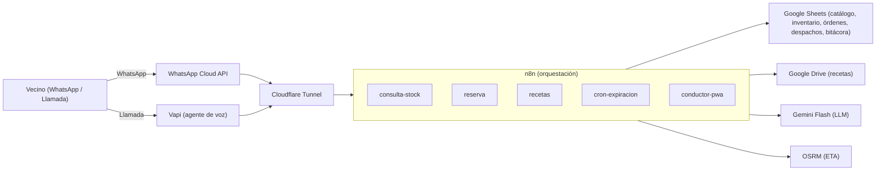

# Arquitectura del Sistema

Visión técnica del prototipo omnicanal de la Farmacia Comunitaria de Peñalolén: un orquestador n8n, autoalojado en Docker y publicado mediante Cloudflare Tunnel, que coordina los canales WhatsApp y voz, persiste el estado operativo en Google Sheets y resguarda las recetas en Google Drive, con Gemini Flash como modelo de lenguaje y OSRM para la estimación de rutas. Todo el diseño se sostiene sobre capas gratuitas ($0 USD) y sin dependencias del ERP SAP (RNF-05, exclusión explícita del alcance).

## Diagrama de componentes

Flujo típico: el vecino escribe por WhatsApp (o llama); la API del canal entrega el mensaje a través del túnel a n8n; el workflow correspondiente consulta o escribe en Google Sheets, invoca a Gemini Flash con los datos del catálogo como única fuente de verdad y responde por el mismo canal. Las recetas se almacenan en Google Drive y solo su URL se registra en la planilla (RNF-07).

## Capas

| Capa | Tecnología | Responsabilidad |
|---|---|---|
| Orquestación | n8n (Docker) | Workflows `consulta-stock`, `reserva`, `recetas`, `cron-expiracion`, `conductor-pwa`; encolamiento secuencial de escrituras (RNF-04) |
| Datos | Google Sheets + Google Apps Script | Catálogo, inventario, órdenes, despachos y bitácora; libro inicializado por `scripts/setup-sheets.gs` (US-01) |
| Inteligencia artificial | Gemini Flash (Google AI Studio) | Diálogo y búsqueda difusa de medicamentos, con grounding estricto al catálogo (R-02) |
| Canales | WhatsApp Cloud API + Vapi | Entrada y salida del vecino por texto y voz (RNF-01, RNF-02) |
| Logística | OSRM + PWA del conductor | ETA y estados de despacho (RF-08) |
| Exposición | Cloudflare Tunnel | Publica n8n sin abrir puertos en el host (RNF-03) |
| Resguardo documental | Google Drive | Fotografías de recetas con permisos restringidos a personal autorizado (RNF-07) |

## Decisiones de arquitectura

| Decisión | Por qué | Referencia |
|---|---|---|
| Google Sheets como base de datos operativa | Mantiene la compatibilidad con las competencias del personal de bodega, que ya trabaja con planillas; evita capacitación y licencias | RNF-06, RNF-05 |
| Desacoplamiento total de SAP | El prototipo no invade la red interna ni la infraestructura del ERP corporativo de Cormup; es una exclusión explícita del alcance | Exclusiones del informe (4.4) |
| Infraestructura exclusivamente en free tier | Costo fijo de $0 USD en licencias durante el semestre; define la selección de cada componente (n8n self-hosted, OSRM demo, cuotas gratuitas) | RNF-05, S-03 |
| Escrituras de reserva secuenciales y encoladas | Google Sheets API se trata como recurso serializado: un solo worker de n8n procesa las reservas en orden para evitar condiciones de carrera y sobreventas | RNF-04, R-01 |
| Caché de lecturas en memoria de n8n | Las consultas de catálogo no deben consumir cuota de la API de Sheets en cada mensaje | R-01 |
| Cloudflare Tunnel en lugar de puertos expuestos | n8n solo escucha en `127.0.0.1`; el túnel sale hacia Cloudflare y evita abrir puertos o exponer el host | RNF-03, RNF-07 |
| Recetas en Google Drive, nunca en la planilla | La planilla solo guarda la URL con permisos restringidos; los documentos clínicos no se copian a la base de datos | RNF-07, S-04 |

## Guardrails y gobernanza fail-safe

| Mecanismo | Comportamiento esperado | Referencia |
|---|---|---|
| Sin consejo clínico | El bot no sugiere dosis ni emite diagnósticos; ante consultas patológicas emite disclaimers sanitarios | RNF-08 |
| Contención clínica | Ante dolor agudo, intoxicaciones o ideación de riesgo se suspende la conversación comercial y se despliegan SAMU 131 y SAPU Peñalolén | Sección 5.2 del informe |
| Degradación elegante | Si el agente de voz se interrumpe, un webhook de contingencia invita al vecino a continuar por WhatsApp o SMS | Sección 5.2 del informe |
| Grounding estricto al catálogo | Al LLM le está prohibido responder desde su memoria paramétrica: solo puede citar datos del catálogo oficial | R-02 |
| Validación humana de recetas | El sistema no interpreta prescripciones (sin OCR); la validación legal corresponde al químico farmacéutico | Exclusiones (4.4), S-04 |
| Calidad antes que velocidad | No se libera ningún incremento con lógica de reserva inconsistente o riesgo de sobreventa | Sección 5.2 del informe |

## Mapa de requerimientos → workflow

| RF | Descripción | Workflow responsable |
|---|---|---|
| RF-01 | Búsqueda difusa por marca, principio activo y dosis | `consulta-stock` |
| RF-02 | Saldo neto (`stock_real - stock_reservado`) y sugerencia de bioequivalentes ante quiebre | `consulta-stock` |
| RF-03 | Generación del código transaccional `#FAR-XXXX` | `reserva` |
| RF-04 | Reserva inmediata de stock al confirmar la orden | `reserva` |
| RF-05 | Ingesta asíncrona de recetas por WhatsApp o correo (IMAP) | `recetas` |
| RF-06 | Cron horario de expiración a 12 horas de órdenes `PENDIENTE_RECETA` | `cron-expiracion` |
| RF-07 | Trazabilidad por RUT o código `#FAR-XXXX` | `consulta-stock` (US-06 amplía el flujo de consultas) |
| RF-08 | Módulo conductor: estados de despacho y ETA con OSRM | `conductor-pwa` |

El agente de voz (US-08, RNF-02) no aporta lógica de negocio propia: Vapi invoca por HTTP los webhooks de `consulta-stock` y `reserva`. Los flujos de escritura comparten la cola secuencial descrita en RNF-04.

## Siguientes pasos

1. Validar el modelo de datos con el personal de bodega (US-01) según [`docs/google-sheets-schema.md`](google-sheets-schema.md).
2. Implementar los workflows de Sprint 1 y versionarlos bajo la convención de [`workflows/README.md`](../workflows/README.md).
3. Resolver la decisión abierta **D-01** antes de implementar `reserva` (ver [`docs/google-sheets-schema.md`](google-sheets-schema.md)).
