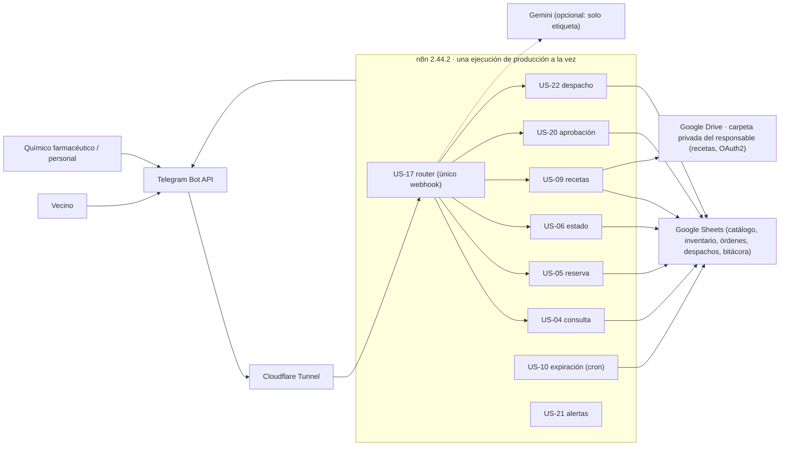

# Arquitectura del Sistema

Visión técnica del prototipo de la Farmacia Comunitaria de Peñalolén: un orquestador n8n 2.44.2, autoalojado en Docker y publicado mediante Cloudflare Tunnel, que atiende el canal Telegram con **un único webhook y un router de intenciones**, persiste el estado operativo en Google Sheets y resguarda las recetas en Google Drive. Todo el diseño se sostiene sobre capas gratuitas ($0 USD) y sin dependencias del ERP SAP (RNF-05, exclusión explícita del alcance).

> **Actualización Entrega 2 (9-nov-2026).** Este documento refleja el sistema real. La voz (Vapi), la app del conductor con OSRM y el canal WhatsApp quedaron **fuera del alcance firmado**; Gemini es **opcional** y solo elige una etiqueta para mensajes ambiguos (nunca redacta respuestas). Los diagramas UML (componentes, despliegue, estados y seis secuencias) están en [`entrega-2/diagramas/`](./entrega-2/diagramas/) y las decisiones en [`entrega-2/decisiones-diseno.md`](./entrega-2/decisiones-diseno.md).

## Diagrama de componentes

Flujo típico: el vecino escribe por Telegram; Telegram entrega el mensaje por el túnel al webhook del router, que valida el secreto, responde de inmediato las urgencias y preguntas clínicas con textos fijos y deriva el resto al subflujo que corresponde. El subflujo vuelve a validar el secreto, lee o escribe la planilla y responde por el mismo canal, siempre con datos de la planilla (sin LLM en las respuestas, R-02). Las recetas llegan como foto, se guardan en una unidad compartida de Drive y solo su URL se registra en la planilla (RNF-07); el químico farmacéutico recibe un aviso para aprobar o rechazar.

### Cambio de canal de mensajería

El canal de texto se migró de WhatsApp Cloud API a Telegram Bot API en el Sprint 1: los bots de Telegram ofrecen mensajes ilimitados sin costo, mientras que la API de Meta pasó a facturar las conversaciones de categoría utilitaria, lo que rompería el objetivo de $0 USD (RNF-05); por eso los webhooks llevan prefijo `telegram-*` y el destinatario se identifica por su `chat_id`.

## Capas

| Capa | Tecnología | Responsabilidad |
|---|---|---|
| Orquestación | n8n 2.44.2 (Docker) | Router US-17 y subflujos US-04, US-05, US-06, US-09, US-10, US-20, US-21 y US-22; una ejecución de producción a la vez (RNF-04, `N8N_CONCURRENCY_PRODUCTION_LIMIT=1`) |
| Datos | Google Sheets | Catálogo, inventario, órdenes, despachos y bitácora; libro preparado por `scripts/local/cargar-catalogo.mjs` (o `scripts/setup-sheets.gs`) |
| Búsqueda e intención | Reglas deterministas en n8n; Gemini opcional | Búsqueda difusa sin LLM (R-02); el LLM, si hay clave, solo elige la etiqueta de un mensaje ambiguo |
| Canal | Telegram Bot API | Entrada y salida del vecino y del personal (RNF-01). Voz y WhatsApp: fuera del alcance firmado |
| Logística | Comandos del personal por Telegram (US-22) | Estados `EN_RUTA` y `ENTREGADO`. La PWA con OSRM queda como prototipo en modo demostración |
| Exposición | Cloudflare Tunnel | Publica n8n sin abrir puertos en el host (RNF-03) |
| Resguardo documental | Google Drive | Fotografías de recetas con permisos restringidos a personal autorizado (RNF-07) |

## Decisiones de arquitectura

| Decisión | Por qué | Referencia |
|---|---|---|
| Google Sheets como base de datos operativa | Mantiene la compatibilidad con las competencias del personal de bodega, que ya trabaja con planillas; evita capacitación y licencias | RNF-06, RNF-05 |
| Desacoplamiento total de SAP | El prototipo no invade la red interna ni la infraestructura del ERP corporativo de Cormup; es una exclusión explícita del alcance | Exclusiones del informe (4.4) |
| Infraestructura exclusivamente en free tier | Costo fijo de $0 USD en licencias durante el semestre; define la selección de cada componente (n8n self-hosted, OSRM demo, cuotas gratuitas) | RNF-05, S-03 |
| Escrituras de reserva secuenciales y encoladas | Implementado en la Entrega 2 con `N8N_CONCURRENCY_PRODUCTION_LIMIT=1`, el router que espera a cada subflujo y `max_connections=1` en Telegram (ADR-07) | RNF-04, R-01 |
| Caché de lecturas en memoria de n8n | Planificado (Sprint 3): las consultas de catálogo no deberían consumir cuota de la API de Sheets en cada mensaje | R-01 |
| Cloudflare Tunnel en lugar de puertos expuestos | n8n solo escucha en `127.0.0.1`; el túnel sale hacia Cloudflare y evita abrir puertos o exponer el host | RNF-03, RNF-07 |
| Recetas en Google Drive, nunca en la planilla | La planilla solo guarda la URL con permisos restringidos; los documentos clínicos no se copian a la base de datos | RNF-07, S-04 |

## Guardrails y gobernanza fail-safe

| Mecanismo | Comportamiento esperado | Referencia |
|---|---|---|
| Sin consejo clínico | El bot no sugiere dosis ni emite diagnósticos; ante consultas patológicas emite disclaimers sanitarios | RNF-08 |
| Contención clínica | Ante dolor agudo, intoxicaciones o ideación de riesgo se suspende la conversación comercial y se despliegan SAMU 131 y SAPU Peñalolén | Sección 5.2 del informe |
| Degradación elegante | Si un subflujo falla, el router avisa al vecino («Tuvimos un problema…», con SAMU 131 si es urgencia) y US-21 alerta al equipo (ADR-10) | Sección 5.2 del informe |
| Grounding estricto al catálogo | Estructural: ningún LLM redacta respuestas; todo nombre, precio y stock sale de la planilla (ADR-03) | R-02 |
| Validación humana de recetas | El sistema no interpreta prescripciones (sin OCR); la validación legal corresponde al químico farmacéutico | Exclusiones (4.4), S-04 |
| Calidad antes que velocidad | No se libera ningún incremento con lógica de reserva inconsistente o riesgo de sobreventa | Sección 5.2 del informe |

## Mapa de requerimientos → workflow

| RF | Descripción | Workflow responsable |
|---|---|---|
| RF-01 | Búsqueda difusa por marca, principio activo y dosis | `consulta-stock` |
| RF-02 | Saldo neto (`stock_real - stock_reservado`) y sugerencia de bioequivalentes ante quiebre | `consulta-stock` |
| RF-03 | Generación del código transaccional `#FAR-XXXX` | `reserva` |
| RF-04 | Reserva inmediata de stock al confirmar la orden | `reserva` |
| RF-05 | Ingesta asíncrona de recetas por Telegram (activo) o correo IMAP (postergado) | `recetas-telegram` (activo) + `recetas-email` (postergado) |
| RF-06 | Cron horario de expiración a 12 horas de órdenes `PENDIENTE_RECETA` | `cron-expiracion` |
| RF-07 | Trazabilidad por RUT o código `#FAR-XXXX` | `trazabilidad` |
| RF-08 | Módulo conductor: estados de despacho y ETA con OSRM | PWA de US-11 (no es un workflow; su endpoint backend sigue pendiente) |

El agente de voz (US-08, RNF-02) no aporta lógica de negocio propia: Vapi invoca por HTTP los webhooks de `consulta-stock` y `reserva`. Los flujos de escritura comparten la cola secuencial descrita en RNF-04.

## Estado y siguientes pasos

- Workflows de Sprint 1 y 2 implementados y versionados bajo la convención de [`workflows/README.md`](../workflows/README.md).
- **D-01 resuelta** el 16-oct-2026 (ver [`docs/google-sheets-schema.md`](google-sheets-schema.md)).
- Pendientes: validación formal con bodega de nombres de columna y enums (checklist en [`docs/google-sheets-schema.md`](google-sheets-schema.md)), prueba de punta a punta en el entorno real (ver [`docs/guia-pruebas-e2e.md`](guia-pruebas-e2e.md)) y el adaptador de WhatsApp Business (GitHub #24).
