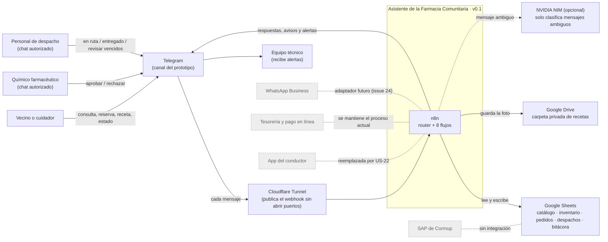
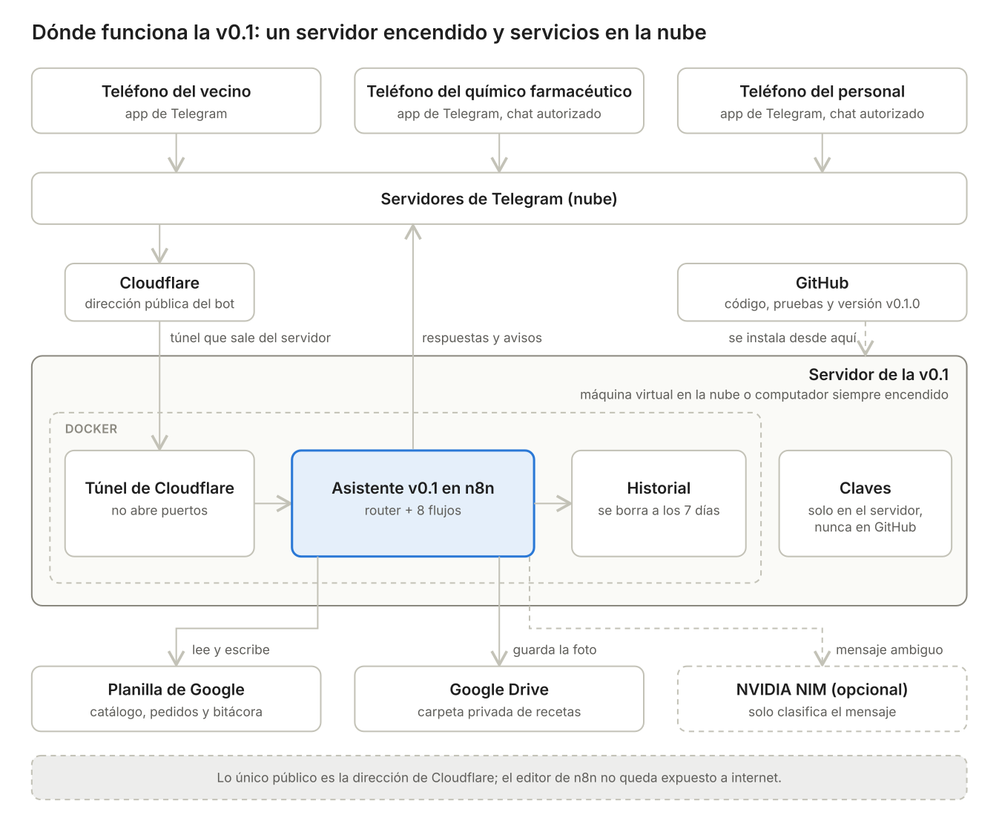

# Arquitectura de la v0.1

Vista general del asistente al cierre del semestre: diagrama de contexto y de despliegue. Los diagramas de detalle (componentes, despliegue, secuencias y estados del pedido) están en [`docs/entrega-2/diagramas/`](../entrega-2/diagramas/) y sus versiones exportadas en [`exportados/`](../entrega-2/diagramas/exportados/).

## 1. Diagrama de contexto

Quién usa el sistema y con qué servicios externos conversa. Lo que está en gris quedó fuera del alcance firmado con la Municipalidad.

Lectura del diagrama:
- Todas las personas usan Telegram. El personal y el químico farmacéutico escriben desde chats autorizados; desde cualquier otro chat, sus comandos se tratan como mensajes comunes.
- El asistente no tiene base de datos propia: la planilla de Google es la fuente de verdad, y las recetas quedan en una carpeta privada de Drive, nunca en la planilla.
- El modelo de lenguaje es opcional. Solo recibe los mensajes que las reglas no entienden y devuelve una etiqueta; nunca redacta respuestas ni decide cifras.

## 2. Diagrama de despliegue de la v0.1

Dónde corre cada pieza en el ambiente preproductivo. Es la versión simplificada, para lectores no técnicos, del diagrama técnico [`despliegue.puml`](../entrega-2/diagramas/despliegue.puml).

Fuente editable: [`diagramas/despliegue-v01.svg`](diagramas/despliegue-v01.svg).

Lectura del diagrama:
- Todo el asistente corre en **un solo servidor** con Docker: una máquina virtual en la nube o un computador del equipo que queda encendido ([ambiente preproductivo](despliegue-preproductivo.md)).
- Telegram entrega cada mensaje en la dirección pública de Cloudflare, y el túnel, que **sale** desde el servidor, lo lleva hasta n8n. No se abre ningún puerto y el editor de n8n no queda expuesto a internet.
- Los datos no viven en el servidor: el catálogo, los pedidos y la bitácora están en la planilla de Google, y las recetas en una carpeta privada de Drive. En el servidor solo quedan el historial de ejecuciones, que se borra a los 7 días, y las claves, que nunca se suben a GitHub.
- El servidor se instala desde la versión etiquetada `v0.1.0` del repositorio.

## 3. Componentes, despliegue técnico y comportamiento

| Diagrama | Fuente | Qué muestra |
|---|---|---|
| Componentes | [`componentes.puml`](../entrega-2/diagramas/componentes.puml) | El router, los subflujos y los servicios externos, con sus interfaces |
| Despliegue (técnico) | [`despliegue.puml`](../entrega-2/diagramas/despliegue.puml) | n8n en Docker, el túnel de Cloudflare y los servicios externos, con versiones y credenciales |
| Secuencias | [`secuencia-*.puml`](../entrega-2/diagramas/) | Consulta, reserva, receta y aprobación, expiración a 12 h, estado y despacho |
| Estados del pedido | [`estados-pedido.puml`](../entrega-2/diagramas/estados-pedido.puml) | 7 estados y 8 transiciones autorizadas |

El ambiente preproductivo de la v0.1 usa el mismo despliegue del diagrama, en un computador que queda encendido: ver [`despliegue-preproductivo.md`](despliegue-preproductivo.md).

## 4. Decisiones que sostienen la arquitectura

- [Dos decisiones explicadas con GRASP y SOLID](decisiones-grasp-solid.md): el router como única puerta de entrada (Controlador) y un flujo por tarea (Responsabilidad única).
- [Registro completo de decisiones (ADR-01 a ADR-13)](../entrega-2/decisiones-diseno.md): n8n y Google Sheets por costo $0, Telegram como canal del prototipo, búsqueda sin IA generativa, ejecuciones en fila para no sobrevender y recetas en Drive con OAuth, entre otras.
